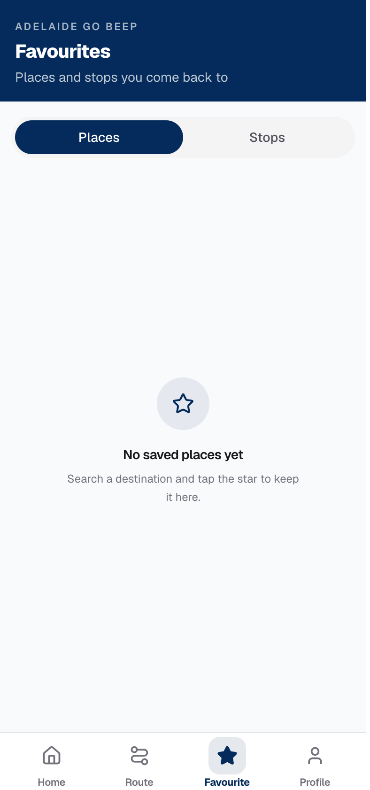
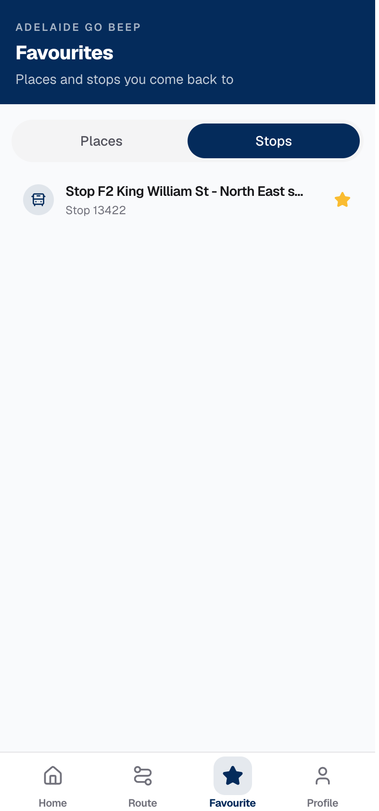

# Favourites

Saved places and stops you come back to — star from Home or Route, open from
here.

## What we push here

### Places vs Stops

Two tabs so destinations and Metro stops don’t mix. Places jump into Route;
stops reopen the same live-arrivals sheet you use on Home.

### Stop identity without noise

Saved stops show the **stop code** (`Stop 13422`), not a mini arrivals feed in
the list. Live times appear after you open the stop.

### Local first, account when you sign in

Signed out → `localStorage` on this device. Sign in with Google → favourites
move into the account (`/api/favourites`) so the same stars show on another
phone. Recents stay device-only.

### Same star everywhere

Home stop detail, Route destination, and this list share one favourite model
(`placeType` + `placeId`), including stop code when we have it.
