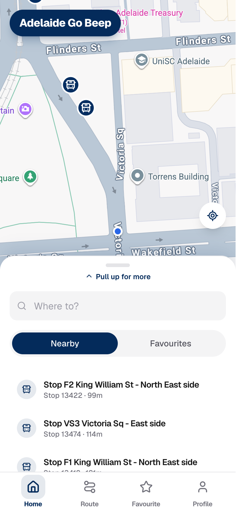
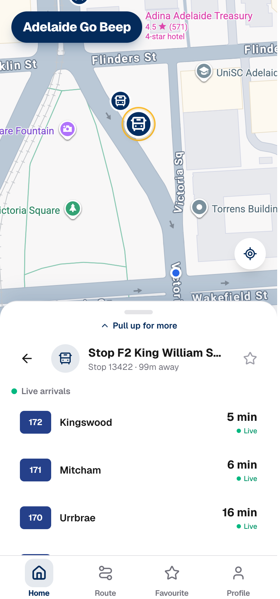

# Home

Map-first screen. Find a stop near you, see live departures, or search where
you’re going.

## What we push here

### Nearby stops that match the map

The list is whatever is in the **visible map bounds**, not a fixed radius. Pan
or zoom and Nearby updates. Each row shows the Metro **stop code** and distance
(e.g. `Stop 13422 · 99m`) so you can match the pole on the street.

### Live arrivals (GTFS-Realtime)

Tap a stop and the sheet switches to departures: route, headsign, countdown,
and a **Live** badge when the prediction comes from the realtime feed (not
only the printed timetable).

### Where to?

The search field jumps to place search (Adelaide-biased), then opens **Route**
with that destination filled in. Star a stop from the arrivals header to pin
it under Favourites.

### Sheet that stays out of the way

Half-height preview, pull up for the full list, collapse to show more map.
“Pull up for more” appears when rows are clipped. Favourites tab in the same
sheet is a quick peek without leaving Home.
