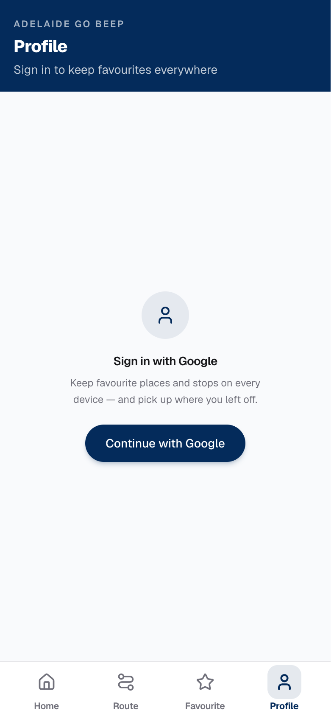

# Profile

Sign-in for favourites that follow you. Session is our JWT cookie — not
Supabase Auth.

## What we push here

### Continue with Google

OAuth through `/api/auth/*`. After sign-in you see your Google name / photo and
can sign out. Subtitle spells the point: **keep favourites everywhere**.

### Why sign in at all

Without an account, stars live only on that browser. With an account they sync
via our favourites API keyed to `app_users`. First sign-in uploads local
favourites into the account.

### Install as an app (PWA)

Safari **Share → Add to Home Screen** (or Chrome install) gets the standalone
shell: theme colour, icons, home-indicator-aware tab bar. Profile is the
natural place to mention that when we add Tips later.
