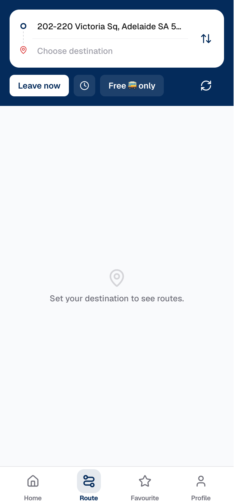
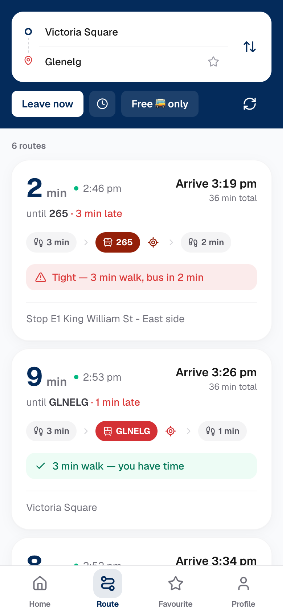
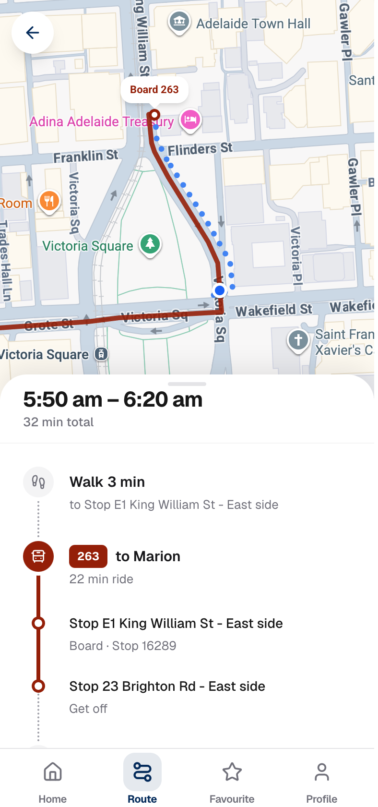

# Route

A→B planner. Google finds the journey; we attach Adelaide Metro stop codes and
live times wherever we can match a GTFS trip.

## What we push here

### Leave now or later

Default is **Leave now**. The clock opens a sheet to pick depart / arrive at a
specific time so night buses and early mornings are plannable.

### Free 🚌 only

Filters the result list to journeys that look free under Adelaide Metro’s free
city rules — useful when you only want those options.

### Catch hints, not just a countdown

Each card shows walk + ride chips and a plain-English buffer, e.g.
**“3 min walk — you have time”**, so you know if you need to hurry before the
bus leaves.

### Live delay vs timetable

Matched rides can show **live** lateness (`1 min late`) instead of only
“Scheduled”. Unmatched Google legs still appear — gaps are expected because
Google doesn’t give a GTFS trip id.

### Detail: walk → board → get off

Opening a card saves a lasting journey id and shows the map with walk
polylines, the board stop, and leg-by-leg steps (walk minutes, route colour,
stop codes). Tap a leg to focus it on the map; live vehicle when the feed has
it.

