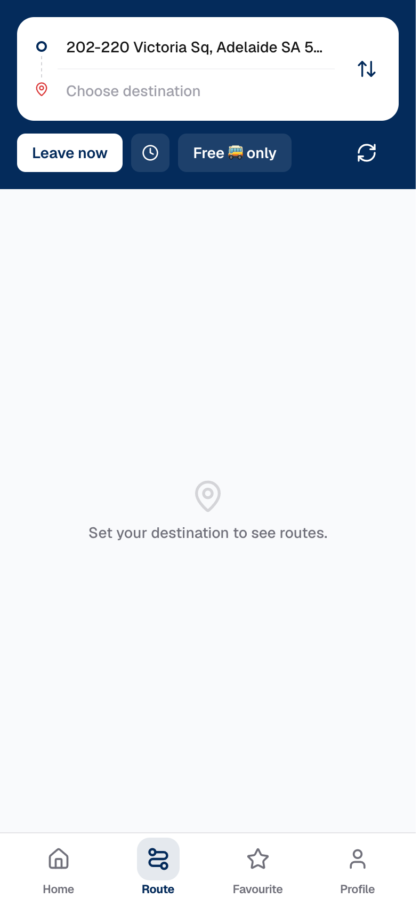
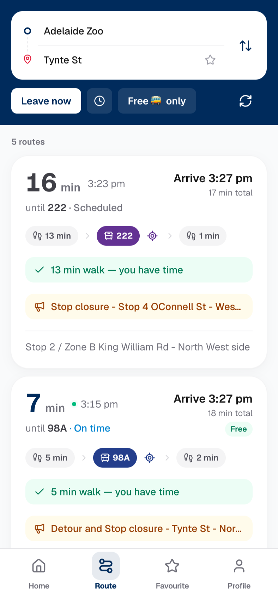
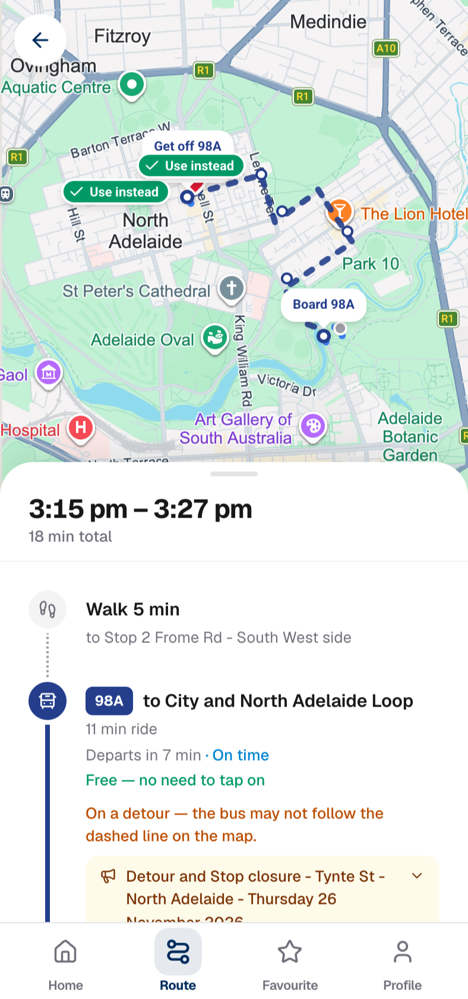

# Route

A→B planner. Our OTP server finds the journey (Google if OTP is down); we
attach Adelaide Metro stop codes, live times and service notices wherever we
can match a GTFS trip.

## What we push here

### Leave now or later

Default is **Leave now**. The clock opens a sheet to pick depart / arrive at a
specific time so night buses and early mornings are plannable.

### Free 🚌 only

Filters the result list to journeys that look free under Adelaide Metro’s free
city rules — useful when you only want those options.

### Catch hints, not just a countdown

Each card shows walk + ride chips and a plain-English buffer, e.g.
**“3 min walk — you have time”**, so you know if you need to hurry before the
bus leaves.

### Live delay vs timetable

Matched rides can show **live** lateness (`1 min late`) instead of only
“Scheduled”. Unmatched legs still appear with the planner's times. The detail
screen refreshes the live status every 30 s.

### Service notices (v1.1)

Adelaide Metro detours and stop closures, only when they touch your ride
(rules: [NOTICES.md](../NOTICES.md)).

- **Card**: amber banner with the newest notice and `+N`.
- **Detail**: each notice under its ride; tap for the text and the Metro link.
  "On your ride" names the closed stop. "Use instead" names where to go when
  the stop you board or get off at is closed.
- **Map**: ⚠ on closed stops, green "Use instead" markers, "See notice" on the
  board/get-off callouts.

### Detours (v1.1)

A ride with a detour notice is drawn **dashed**: no feed gives the real path,
so the usual line may be wrong. The detail says so too. Other rides stay
solid.

### Detail: walk → board → get off

Opening a card saves a lasting journey id and shows the map with walk
polylines, the board stop, and leg-by-leg steps (walk minutes, route colour,
stop codes). Tap a leg to focus it on the map; live vehicle when the feed has
it.

